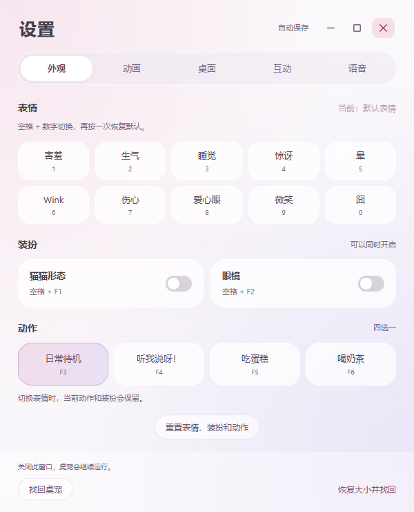
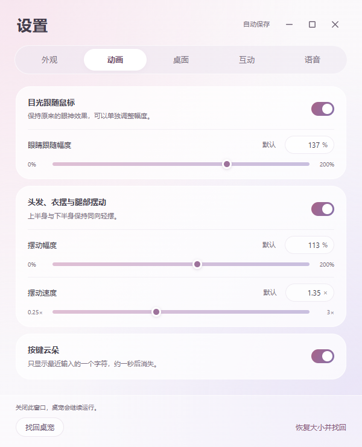
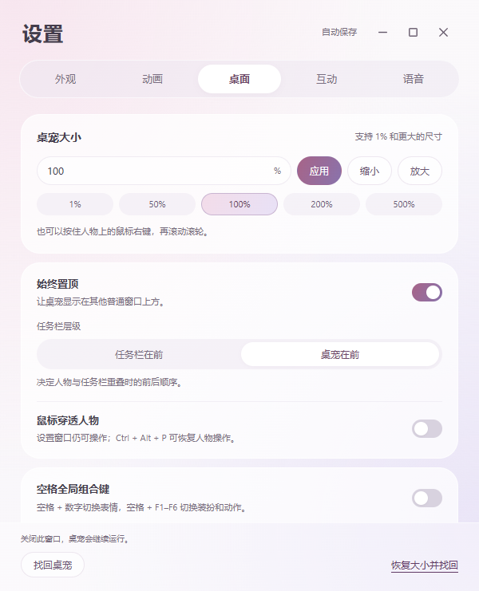
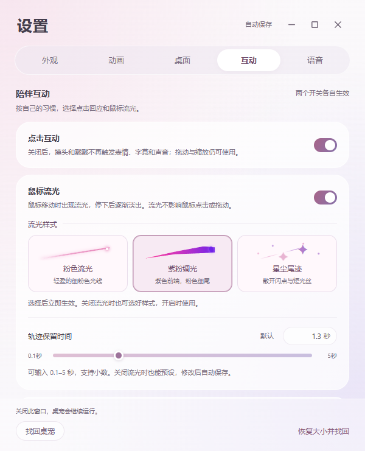
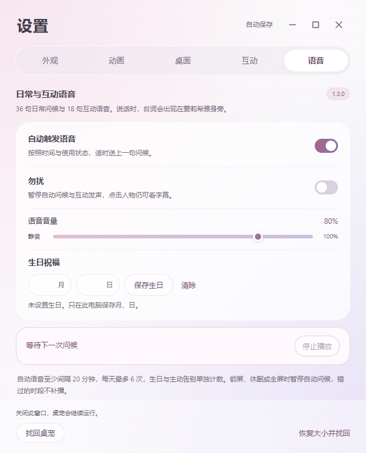

<h1 align="center">Elysia Desktop Pet</h1>

<p align="center">Elysia_desktop_pet · A little Elysia for your desktop</p>

<p align="center"><a href="README.md">简体中文</a> · <strong>English</strong></p>
<p align="center"><a href="#download">Download</a> · <a href="#character-gallery">Gallery</a> · <a href="#usage">Usage</a> · <a href="#run-from-source">Run from source</a></p>

A chibi Elysia companion for Windows, with a transparent full-body character, mouse-following eyes, and gentle motion. Mix expressions, cat mode, glasses, and four actions, with little clouds that respond to your typing. Includes local chat, optional read-aloud replies, automatic model setup, conversation history management, and body-region interactions. Version 1.4.2 switches to app-managed llama.cpp and fixes manual reading blocked by Windows busy-state detection.

**Current test version: 1.4.2, not a stable release.** The local builds in `release/` include fixes for manual speech reuse, long messages, and chat runtime dependencies. The remote downloads below do not yet include these local fixes; no 1.4.2 GitHub Release has been created. See [Local chat and read-aloud](#local-chat-and-read-aloud) and the [1.4.2 release notes and verification scope](docs/releases/v1.4.2.md).

## Download

| Edition | Program | Features | Checksum |
| --- | --- | --- | --- |
| 1.4.2 Windows installer (test) | [Download installer](https://media.githubusercontent.com/media/ActorF/Elysia_desktop_pet/version-control/release/Elysia_desktop_pet-1.4.2-setup.exe) | Full features, including chat and optional read-aloud replies | [SHA256](https://raw.githubusercontent.com/ActorF/Elysia_desktop_pet/version-control/release/Elysia_desktop_pet-1.4.2-setup.exe.sha256) |
| 1.4.2 Windows portable (test) | [Download EXE](https://media.githubusercontent.com/media/ActorF/Elysia_desktop_pet/version-control/release/Elysia_desktop_pet-1.4.2.exe) | Same features; double-click to run | [SHA256](https://raw.githubusercontent.com/ActorF/Elysia_desktop_pet/version-control/release/Elysia_desktop_pet-1.4.2.exe.sha256) |
| 1.3.0 Windows portable | [Download EXE](https://github.com/ActorF/Elysia_desktop_pet/releases/download/v1.3.0/Elysia_desktop_pet-1.3.0.exe) | **No chat or read-aloud replies**; daily and click-interaction recordings remain included | [SHA256](https://github.com/ActorF/Elysia_desktop_pet/releases/download/v1.3.0/Elysia_desktop_pet-1.3.0.exe.sha256) |

Click these links to download the complete program; Git, Git LFS, and Node.js are not required. Both 1.4.2 editions automatically prepare chat and speech dependencies on first run, which requires an internet connection. Version 1.3.0 does not download chat or speech-synthesis models.

Run `Elysia_desktop_pet-1.4.2-setup.exe` to install the app, or double-click the portable EXE to run it. Before upgrading, quit the old version from the tray. Position, size, outfit switches, and preferences in your existing release profile are preserved without manual migration.

[1.3.0 release notes](docs/releases/v1.3.0.md) · [1.3.0 release page](https://github.com/ActorF/Elysia_desktop_pet/releases/tag/v1.3.0) · [Source and build instructions](#run-from-source)

<details>
<summary>Download warnings and files ending in .crdownload</summary>

The app is currently unsigned. If Microsoft Edge says the file “isn't commonly downloaded,” confirm you used one of the program links above. In the downloads list, choose **⋯ → Keep → Show more → Keep anyway**, then wait for the download to finish. See [Microsoft's instructions](https://learn.microsoft.com/en-us/troubleshoot/microsoft-edge/development/download-failures#check-security-and-smartscreen-settings).

**If the download has fully completed but the file is still named `Unconfirmed <number>.crdownload`, you can rename it to use the `.exe` extension.** Enable **File name extensions** in File Explorer, then use **`Elysia_desktop_pet-1.4.2.exe`** or **`Elysia_desktop_pet-1.4.2-setup.exe`**, matching the edition you downloaded. Remove the trailing `.crdownload` entirely.

This only applies to a file that has finished downloading. If the download is still running or was interrupted, complete it first; renaming an incomplete file does not finish the download.

</details>

## Character gallery

### Full-body character

<p align="center">
  
</p>

<p align="center"><a href="docs/media/idle.webm">Watch the idle animation</a></p>

### Expressions

There are **11 facial states**: Neutral, Blush, Angry, Sleep, Surprised, Dizzy, Wink, Sad, Heart Eyes, Smile, and Awkward.


### Forms

Cat mode and glasses are independent switches. Use the original appearance, cat mode, glasses, or both together. Your choices stay active when you change expressions or actions, and after restarting the app.


### Actions

Choose one of four actions: **Idle, Megaphone, Cake, or Bubble tea**. Changing an expression or outfit keeps the current action. The megaphone does not play sound.


### Key clouds

A pale pink-and-white cloud shows a single character above her hand during Idle, Cake, and Bubble tea. With Megaphone selected, it floats outward from the horn with illustrated sound waves, fading within about a second.


<p align="center"><a href="docs/media/megaphone-key-cloud.webm">Watch the megaphone key effect</a> · Visual effect only, no sound</p>

## Usage

### Mouse and system tray

| Control | What it does |
| --- | --- |
| Hold the left mouse button on the character and drag | Move her freely, including partly beyond any edge of the screen |
| Left-click her head or body | Pat her head or poke her; the fifth click across both areas within three seconds triggers an annoyed response |
| Hold the right mouse button on the character and scroll | Scroll up to enlarge or down to shrink; starts at 1% with no fixed upper size limit |
| Click or right-click the system tray icon | Open the menu for Settings (`设置`), Open chat (`打开聊天框`), and Quit (`退出`) |
| Choose Settings (`设置`) | Open a separate settings window while the pet stays visible |
| Choose Open chat (`打开聊天框`) | Open a separate window for typing messages |
| Choose Bring back (`找回桌宠`) at the bottom of Settings, or press `Ctrl + Alt + P` | Bring her back into view and turn off click-through |
| Choose Restore size and bring back (`恢复大小并找回`) at the bottom of Settings | Restore 100% size and bring her back onto the screen |
| Choose Quit (`退出`) in the tray | Close the entire app |

Transparent space around the character lets clicks pass through to the windows behind her. Scrolling alone does not resize her, and right-clicking the character does not open Settings.

The new tray icon is a pink emblem on a transparent background. Position, size, and preferences are saved automatically.

Version 1.4.2 keeps the existing release profile in `%APPDATA%/Elysia Desktop Pet/`, preserving position, size, appearance, and preferences. Quit the old app from its tray before starting the new version; existing release settings need no manual migration.

### Settings window

Settings and the pet stay on screen together, and you can move or resize the window independently. Drag its empty header area to move it. The three standard icons at the top right minimize, maximize/restore, and close the window. Closing Settings leaves the pet running. There are seven tabs: **Appearance, Animation, Desktop, Interaction, Voice, Chat, and Chat history**.

<table>
  <tr><th>Appearance</th><th>Animation</th><th>Desktop</th></tr>
  <tr>
    <td><a href="docs/media/settings-appearance.png"></a></td>
    <td><a href="docs/media/settings-animation.png"></a></td>
    <td><a href="docs/media/settings-desktop.png"></a></td>
  </tr>
</table>

<table>
  <tr><th>Interaction</th><th>Voice</th></tr>
  <tr>
    <td><a href="docs/media/settings-interaction.png"></a></td>
    <td><a href="docs/media/settings-voice.png"></a></td>
  </tr>
</table>

Click a screenshot to view it at full size. The app currently uses Chinese labels.

- **Appearance (`外观`):** choose expressions, cat mode, glasses, and one of four actions. Keyboard shortcuts also update the window.
- **Animation (`动画`):** toggle eye tracking, sway, and key clouds. Adjust the parameters below with sliders or number fields, or restore their defaults.
- **Desktop (`桌面`):** change character size, always-on-top behavior, taskbar order, click-through, and shortcuts. Enter a size percentage starting at 1%, with no fixed upper size limit.
- **Interaction (`互动`):** toggle click responses and cursor trails independently, and choose the trail style and duration.
- **Voice (`语音`):** control automatic greetings, Do not disturb, volume, and birthday month/day, and view playback status. The release UI has no audition or simulated-trigger tools.
- **Chat (`聊天`):** change your username, toggle automatic read-aloud, and check independent model and speech setup progress. Advanced options support a compatible chat service or speech environment.
- **Chat history (`聊天记录`):** select a conversation in the left list and read its messages on the right. Continue chatting, delete one conversation, or clear history after confirmation.

| Animation parameter | Range | Default |
| --- | --- | --- |
| Eye follow strength (`眼睛跟随幅度`) | 0–200% | 100% |
| Sway amplitude (`摆动幅度`) | 0–200% | 100% |
| Sway speed (`摆动速度`) | 0.25–3× | 1× |

Eye tracking keeps the original effect at its default strength: 0% removes the deformation, while 200% strengthens it. The upper and lower parts sway in the same direction; 0% amplitude stops the sway. Turning either feature off and back on keeps its values.

Enable Always on top (`始终置顶`) to choose Taskbar in front (`任务栏在前`) or Pet in front (`桌宠在前`); Pet in front is the default. Settings remains usable while the pet is in click-through mode, and the buttons at the bottom can bring her back at any time.

Version 1.4.1 fixes the pet falling behind ordinary apps when a secondary taskbar is out of order or another topmost app covers her. Taskbar in front mode restores taskbars above the pet and the pet above ordinary apps, preserving taskbar geometry, visibility, and keyboard focus. Captions and cursor-trail windows keep their relative order, and disabling always-on-top or switching modes restores the current setting. This applies to the ordinary Windows desktop, without promising precedence over the secure desktop, exclusive fullscreen, or special system layers.

### Local chat and read-aloud

Choose **Open chat (打开聊天框)** from the tray. Enter sends; Shift + Enter adds a line. First run requires an internet connection to prepare llama.cpp, the default Qwen chat model, and speech resources; Ollama is no longer required. The app starts its own background chat service, releases it on exit, and starts it again on the next launch. **Settings → Chat** shows separate chat and speech progress, cancellation, and retry.

In **Settings → Chat**, change your username or enable automatic read-aloud, which is **off by default**. Use the icons below messages to copy text or choose **Read Aloud** for one reply without changing that setting. Loading the speech model for the first time can take a while; wait for the status to update.

Manual reading is no longer blocked by ordinary fullscreen or Windows busy-state detection. It still respects Do not disturb, mute, screen lock, and suspend, and failed requests explain the reason. Automatic speech retains screen-state restrictions.

**Settings → Chat history (聊天记录)** lets you view or delete local conversations after confirmation. Upgrades retain your username, history, and preferences; old default chat connections migrate while custom connections are preserved. Custom services must support OpenAI-compatible streaming chat. The persona prompt is in [electron/chat-persona.md](electron/chat-persona.md). Resource sizes and verification limits are in the [1.4.2 release notes](docs/releases/v1.4.2.md).

### Daily voices and speech bubbles

Elysia has **36 daily voice lines**, displayed in speech bubbles as she speaks. In **Settings → Voice (`语音`)**, adjust volume, enable Do not disturb, or save your birthday month and day.

### Head pats and pokes

Left-click her head for a pat or her body for a poke, with **18 recorded responses**. Repeated clicks can make her pretend to be annoyed. Toggle **Click interactions (`点击互动`)** in Settings → Interaction independently of daily voices and cursor trails.

### Cursor trails

Enable **Cursor trail (`鼠标流光`)** in the Interaction tab to leave a trail while moving the mouse across the desktop. Cursor trails and click interactions are independent and enabled by default. The overlay lets clicks through and does not take keyboard focus.

| Style | Appearance |
| --- | --- |
| Pink glow (`粉色流光`) | The default fine pink line |
| Purple-pink ribbon (`紫粉绸光`) | A thick purple head fading along the path into a thin rose-pink tail |
| Stardust (`星尘尾迹`) | Small sparkles with short light strands |

**Trail duration accepts decimal values from 0.1 to 5 seconds; the default is 0.6 seconds.** Enter a value such as `1.3` or `2.5`, or use the slider in 0.1-second steps. Default (`默认`) restores 0.6 seconds. You can choose a style and duration while the trail is off. Changing either value or turning the trail off immediately clears the old trail, and preferences are saved automatically.

Fast flicks, circles, and multiple displays are supported. Crossing displays or returning from lock/sleep starts a new path instead of connecting to an old point on another display or before the interruption.

### Key cloud behavior

A cloud displays **only the most recently typed character**. It supports `0–9`, `a–z`, `A–Z`, and English punctuation and symbols. A space is shown as `␣`. Letter case and symbols follow Shift and Caps Lock.

Enter, Ctrl, Tab, arrow keys, and other control keys are not displayed, nor are shortcuts using Ctrl, Alt, or the Windows key. Each new character replaces the previous one and disappears in about a second. Clouds fade above her hand in the regular actions; Megaphone sends them toward the upper left with illustrated sound waves. No sound is played.

Toggle **Key cloud** (`按键云朵`) in the Animation tab without affecting expression shortcuts. Input is used only for the immediate display and is never recorded or saved.

### Expression shortcuts

Hold **Space**, then press a number on either the number row or the numeric keypad. Triggering the same expression again restores the neutral face, while keeping the current action and outfit.

| Shortcut | Expression | Shortcut | Expression |
| --- | --- | --- | --- |
| Space + 1 | Blush | Space + 2 | Angry |
| Space + 3 | Sleep | Space + 4 | Surprised |
| Space + 5 | Dizzy | Space + 6 | Wink |
| Space + 7 | Sad | Space + 8 | Heart Eyes |
| Space + 9 | Smile | Space + 0 | Awkward |

### Outfit and action shortcuts

| Shortcut | Feature | Behavior |
| --- | --- | --- |
| Space + F1 | Cat mode | Toggle independently |
| Space + F2 | Glasses | Toggle independently |
| Space + F3 | Idle | Select this action |
| Space + F4 | Megaphone | Select this action |
| Space + F5 | Cake | Select this action |
| Space + F6 | Bubble tea | Select this action |
| Space + Backspace | Reset appearance | Restore the neutral face and Idle action; turn off cat mode and glasses |

Space shortcuts work while other windows are active and do not block those apps from receiving your keystrokes. You can disable them in Settings → Desktop (`桌面`), or enable the alternative **Ctrl + Alt + number / F key / Backspace** shortcuts. Expressions, outfits, and actions are also available directly in the Appearance (`外观`) tab.

## Run from source

Requires **Windows and Node.js 22 or later**. Executables in `release/` use Git LFS; install Git LFS before cloning and use the commands below to retrieve the complete EXEs instead of small pointer files. To use the app, simply download it above without installing Git. Browser-based visual checks also require Microsoft Edge.

```powershell
git lfs install
git clone --branch version-control https://github.com/ActorF/Elysia_desktop_pet.git
cd Elysia_desktop_pet
git lfs pull
npm ci
npm start
```

Run checks and build both release packages:

```powershell
npm test
npm run test:smoke
npm run test:visual
npm run test:faces
npm run test:zoom
npm run test:settings
npm run test:voice
npm run test:interactions
npm run test:interaction-settings
npm run test:chat
npm run test:chat-native
npm run make:release
npm run verify:release
```

`npm run make:release` (`node scripts/package-release.cjs`) creates `release/Elysia_desktop_pet-1.4.2.exe` and `release/Elysia_desktop_pet-1.4.2-setup.exe`. Build them individually with `npm run make:portable` or `npm run make:setup`. `npm run verify:release` (`node scripts/verify-package.cjs`) verifies the release package. These commands do not publish to GitHub. Prepare the speech asset archive before building; `npm run package` produces an unpacked application directory.

See the [1.4.2 release notes](docs/releases/v1.4.2.md#english-summary) for chat and speech results, known check limitations, and the second-PC checklist. A complete first installation on a fresh Windows environment remains pending. Full commands and checks are in the [verification guide](docs/verification.md), currently in Chinese.

## Project structure

| Path | Contents |
| --- | --- |
| `electron/` | Pet, chat, settings, speech and trail windows; chat/history, voice scheduling, model setup, tray, shortcuts, and saved preferences |
| `renderer/` | Character drawing, expressions, actions, body-region interactions, chat/history, captions, cursor trails, and settings UI |
| `assets/character/` | Character artwork required by the app |
| `assets/ui/` | System tray icon |
| `assets/voice/`, `assets/interaction-voice/` | 36 daily recordings, 18 interaction recordings, and checksum manifests |
| `scripts/` | Launch, package verification, and preview tools |
| `tests/` | Automated tests |
| `docs/` | Character previews, release notes, and verification documentation |
| `release/` | Windows installer, portable app, and checksums; 1.4.2 EXEs are stored on `version-control` through Git LFS |
| `LICENSE` | MIT license for the code |

The app uses an Electron transparent window, composited PNG artwork, and WebGL mesh animation. When WebGL is unavailable, it displays the statically composited character.

## License & credits

Code uses the [MIT License](LICENSE). Elysia, *Honkai Impact 3rd*, and related characters and brands belong to miHoYo / HoYoverse and their rights holders; CoCo Fresh Tea & Juice belongs to its rights holders. This is an unofficial fan project. Its synthesized recordings are not official game audio, and the code license does not grant character, brand, or related voice rights. See the [asset notice](ASSET-NOTICE.md).
